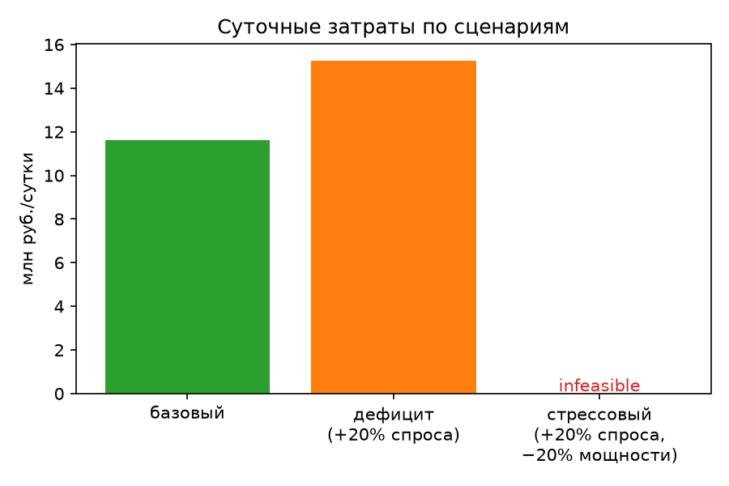
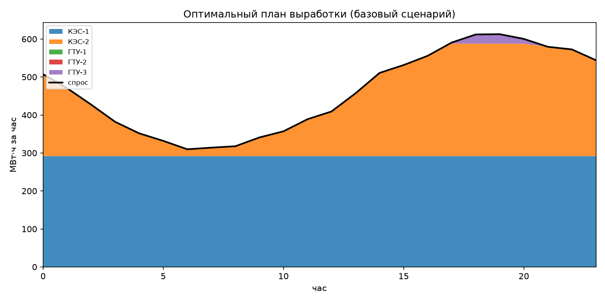
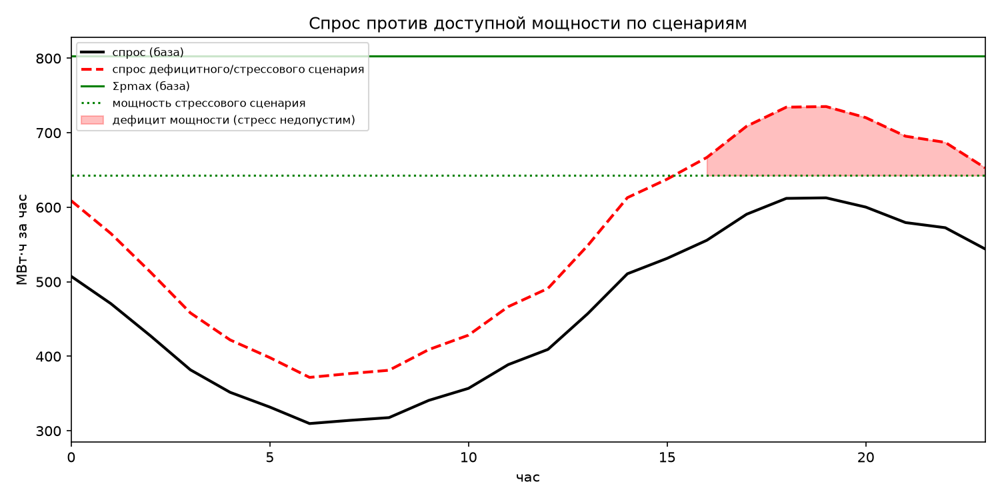
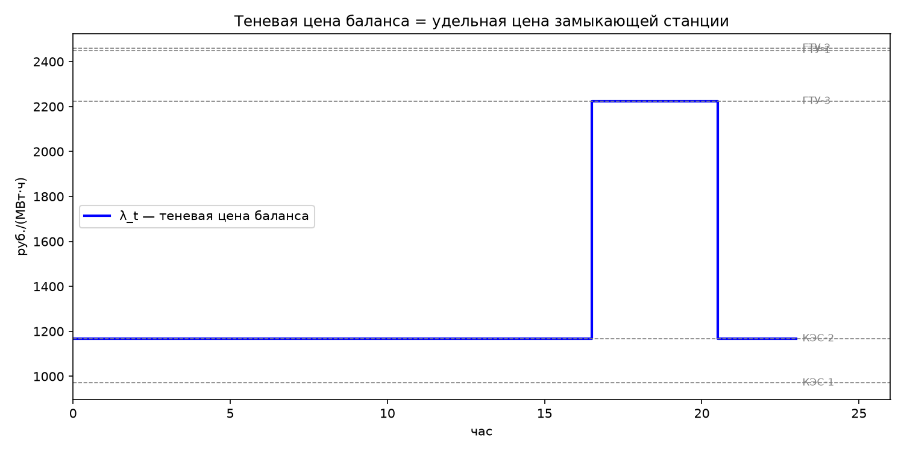
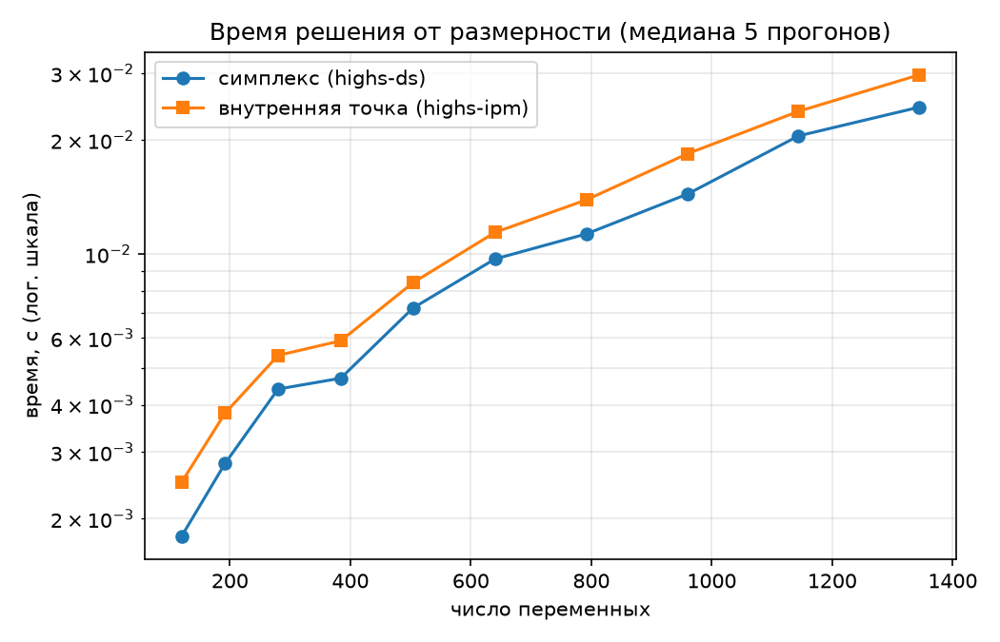
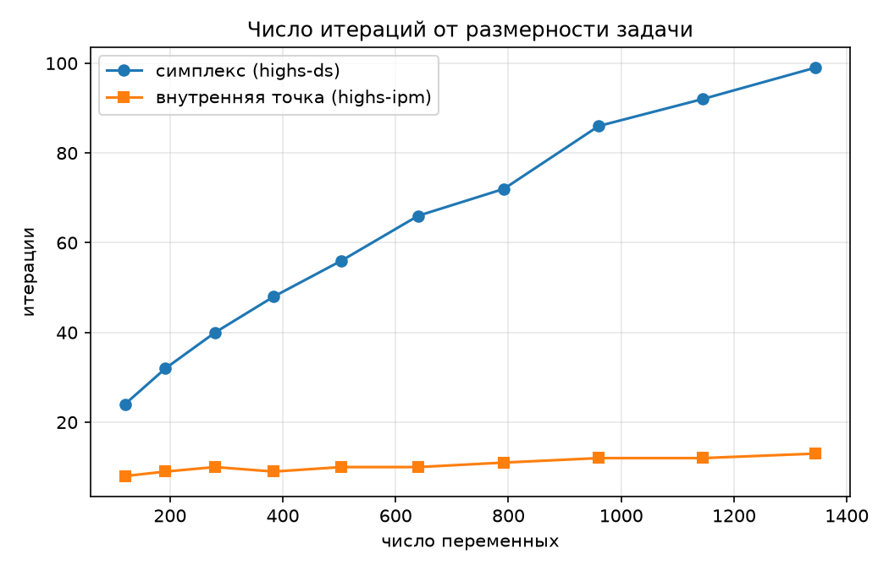

# ОТЧЁТ. Лабораторная работа № 1: ЛП-модель распределения ресурсов

**Вариант 6.** План выработки электроэнергии станциями: минимум затрат (5 станций, 24 ч)
Студент: Осипов В. А., группа Б24-517. Параметры: N = 16, Q = 1, Y = 26;
V = 1 + ((17·16 + 7·1 + 26) mod 20) = **6**; seed данных = **10116**.
Запуск всей работы: `python main.py` (конвейер: данные → модель → решение → проверка → эксперименты → графики).

## 1. Постановка задачи и индивидуальный вариант

Энергосистема из пяти станций (две угольные КЭС — крупные и дешёвые, но
маломанёвренные; три газотурбинные установки — дорогие, но быстрые) должна
покрыть почасовой спрос на горизонте 24 ч с минимальными суммарными затратами.
Данные синтетические, детерминированная генерация по seed = 10116
(`src/data_gen.py`, файлы `data/stations.csv`, `data/demand.csv`, процедура —
`data/README.md`): тот же seed даёт те же данные.

Сгенерированные параметры станций:

| Станция | Тип | Цена, руб./(МВт·ч) | pmax, МВт | Темп, МВт/ч |
| --- | --- | --- | --- | --- |
| КЭС-1 | базовая | 970.7 | 291.6 | 68.3 |
| КЭС-2 | базовая | 1167.2 | 296.2 | 63.6 |
| ГТУ-1 | пиковая | 2450.0 | 71.0 | 189.9 |
| ГТУ-2 | пиковая | 2459.6 | 78.8 | 152.6 |
| ГТУ-3 | пиковая | 2223.3 | 65.9 | 168.2 |

Суммарная мощность 803.4 МВт. Спрос — суточный профиль с вечерним пиком
612.7 МВт·ч (час 19) и ночным минимумом 309.8 МВт·ч (час 6); суточное
потребление ≈ 11 076 МВт·ч.

## 2. Формальная модель

**Множества:** S = {1,…,5} — станции; T = {0,…,23} — часы.

**Параметры:** c_s — удельная стоимость выработки, руб./(МВт·ч);
p_s^max — максимальная мощность, МВт; r_s — допустимый темп изменения
мощности, МВт/ч; d_t — спрос часа t, МВт·ч.

**Переменные:** x_{s,t} ≥ 0 — выработка станции s в часе t, МВт·ч
(численно равна средней мощности, МВт). Всего 120 переменных.

**Цель** (минимум затрат на сутки, руб.):

    min Σ_{s∈S} Σ_{t∈T} c_s · x_{s,t}

**Ограничения:**

1. баланс мощности (для каждого часа t): Σ_s x_{s,t} = d_t — спрос покрывается
   ровно, без перепроизводства;
2. мощность станции: 0 ≤ x_{s,t} ≤ p_s^max (для всех s, t);
3. темп изменения мощности: |x_{s,t} − x_{s,t−1}| ≤ r_s (для всех s, t = 1..23)
   — станцию нельзя разогнать или остановить мгновенно.

Размерность задачи: 120 переменных, 24 равенства (баланс), 230 неравенств
(темп, по два на пару «станция, час») и 240 граничных условий (по две
на переменную). Форма — стандартная: min cᵀx, A_eq·x = b_eq, A_ub·x ≤ b_ub,
lb ≤ x ≤ ub.

## 3. Допущения и учебные упрощения

- **Нет статуса включения (unit commitment):** станция может работать на любой
  мощности из [0, p_max] и в любой момент простаивать с x = 0. Учёт минимальной
  технической мощности и затрат на пуск требует бинарных переменных — это MILP
  (тема ЛР № 3), здесь сознательно не делается.
- **Стоимость строго линейна** по выработке: игнорируются нелинейная расходная
  характеристика, пусковые затраты и затраты на обслуживание под нагрузкой.
- **Спрос детерминирован** и известен точно; резерв мощности, потери в сетях и
  сетевые ограничения не учитываются.
- Ограничение темпа действует только внутри горизонта (начальное состояние
  станций не задаётся).

## 4. Реализация

- **Солвер:** HiGHS 1.12.0 через `scipy.optimize.linprog(method='highs')`
  (scipy 1.18.1, Python 3.12.3; версии зафиксированы в `requirements.txt`).
  Проприетарных солверов нет.
- **Интерфейс модели:** данные (CSV) → `src/model.py` собирает c, A_eq, b_eq,
  A_ub, b_ub, bounds (плотные массивы NumPy) → `linprog`. Модель в коде,
  данные отдельно — сценарии реализуются масштабированием данных, а не правкой модели.
- **Алгоритм:** `method='highs'` автоматически выбрал двойственный симплекс
  (в логе: «Using EKK dual simplex solver»).
- **Presolve:** включён по умолчанию: 254 строки → 70 (−184), 580 → 212 ненулевых.
  Решение — 24 итерации симплекса, время ~0.02–0.03 с (лог: `output/solver_log.txt`).
- Лог HiGHS пишется в файл перехватом файлового дескриптора stdout (HiGHS выводит
  лог в fd 1 напрямую, мимо `sys.stdout`).

## 5. Статус решения и его интерпретация

Базовый и дефицитный сценарии: **optimal** — для ЛП это глобальный оптимум
(задача выпуклая; в логе P-D objective error 2.4e-16). Стрессовый сценарий:
**infeasible** — допустимых планов нет; это содержательный результат, а не сбой:
конфликт ограничений показан явно (раздел 7). Unbounded в этой модели возникнуть
не может: все переменные ограничены сверху (x ≤ pmax), целевая с неотрицательными
коэффициентами ограничена снизу нулём.

## 6. Независимая проверка (чистый NumPy, без объекта солвера)

`src/verify.py` читает данные варианта и проверяет план x напрямую:
баланс (24 проверки), верхняя граница мощности (120), неотрицательность (120),
темп (115), плюс пересчёт целевой функции. Допуск **1e-7**. Полная таблица —
`output/verification.csv`, сводка:

| Тип ограничения | Проверок | Максимальное нарушение | В допуске |
| --- | --- | --- | --- |
| баланс = | 24 | 0.0 | да |
| мощность ≤ | 120 | 0.0 | да |
| неотрицательность ≥ | 120 | 0.0 | да |
| темп ≤ | 115 | −9.99 (запас до границы) | да |

Пересчёт цели: Σ c_s·x_{s,t} = **11 619 786.732777 руб.** — совпадает с
`res.fun`: **|пересчёт − солвер| = 3.73e-09 руб.** (зафиксировано в
`output/verification_summary.txt` вместе со сводкой по типам ограничений).
**Все 379 проверок пройдены в допуске 1e-7**; каждый допустимый сценарий
конвейера дополнительно защищён `assert` на независимую проверку.
Фрагмент таблицы «ограничение → использование/запас» (баланс):

| Ограничение | Использование, МВт·ч | Запас (спрос), МВт·ч | Нарушение |
| --- | --- | --- | --- |
| баланс, час 6 | 309.8 | 309.8 | 0.0 |
| баланс, час 13 | 457.2 | 457.2 | 0.0 |
| баланс, час 19 | 612.7 | 612.7 | 0.0 |

## 7. Сценарный анализ

| Сценарий | Изменение данных | Статус | Затраты, руб. | Δ к базе, руб. |
| --- | --- | --- | --- | --- |
| Базовый | — | optimal | 11 619 786.73 | — |
| Дефицитный | спрос ×1.2 во все часы | optimal | 15 272 337.18 | +3 652 550.44 (+31.4%) |
| Стрессовый | спрос ×1.2 **и** мощность всех станций ×0.8 | **infeasible** | — | — |

**База в предметных терминах** (`output/solution.csv`): КЭС-1 (самая дешёвая)
работает на максимуме все 24 ч — 6999 МВт·ч за сутки; КЭС-2 маневрирует,
добирая спрос до максимума (4012 МВт·ч, на максимуме 4 вечерних часа);
ГТУ-3 включается только в вечерний пик (часы 17–20, 64 МВт·ч); ГТУ-1 и ГТУ-2
не нужны вовсе. Средняя цена выработки 1050 руб./МВт·ч.

**Дефицит (+20% спроса).** Дорогой пик вырос сильнее дешёвой базы, поэтому
план «вымывает» мощность снизу вверх: КЭС-1 осталась на максимуме (она и так
исчерпана), КЭС-2 +1285 МВт·ч (на максимуме уже 11 ч), ГТУ-3 +558, впервые
включаются ГТУ-1 (352 МВт·ч) и ГТУ-2. Затраты +31.4% при росте спроса +20% —
рост сверхлинейный, потому что каждая дополнительная МВт·ч покупается всё
дороже (замыкающая станция дорожает от 2223 до 2459.6 руб./МВт·ч).

**Стресс (двойное ухудшение): спрос ×1.2, мощность ×0.8.** Статус infeasible.
Конфликт виден напрямую из данных (`output/stress_conflict.csv`): в часы 16–23
требуемая выработка 1.2·d_t (653.0–735.2 МВт·ч) превышает суммарно доступную
мощность 0.8·Σpmax = 642.7 МВт·ч:

| Час | Требуемая выработка, МВт·ч | Доступная мощность, МВт·ч | Дефицит, МВт·ч |
| --- | --- | --- | --- |
| 16 | 666.9 | 642.7 | 24.2 |
| 18 | 734.4 | 642.7 | 91.6 |
| 19 | 735.2 | 642.7 | 92.5 |
| 23 | 653.0 | 642.7 | 10.3 |

Конфликтуют **баланс** (спрос обязан быть покрыт) и **ограничения мощности
станций** (их сумма меньше спроса) — это 8 часов пиковой части суток; в ночные
часы задача осталась бы выполнимой. Снятие конфликка: сброс спроса (управление
нагрузкой), резерв/импорт мощности, либо частичный возврат мощности станций.

## 8. Теневые цены активных ограничений и сверка со сценариями

Теневые цены баланса λ_t (`res.eqlin.marginals`, `output/duals.csv`): 1167.2
руб./(МВт·ч) в часы 0–16 и 21–23 и 2223.3 руб./(МВт·ч) в часы 17–20.
Предметный смысл: λ_t равна удельной цене **замыкающей** (последней
вовлечённой) станции — днём это КЭС-2 (1167.2), вечерним пиком — ГТУ-3 (2223.3).

**Сверка прогноза с фактом** (`output/shadow_check.csv`):

| Проверка | Прогноз по λ, руб. | Фактическое Δ затрат, руб. |
| --- | --- | --- |
| микросценарий: +10 МВт·ч к спросу в час 19 | λ_19·10 = 22 233.46 | 22 233.46 |
| дефицит: +20% спроса во все часы | Σ λ_t·0.2·d_t = 3 095 788.76 | 3 652 550.44 |

- **Микросценарий:** прогноз теневой цены совпал с фактом **точно** (базис не
  изменился: у ГТУ-3 в часе 19 есть запас мощности ~41 МВт·ч, поэтому λ_19
  действует при малых приращениях спроса).
- **Дефицит +20%:** прогноз занижен на ~15% (3.10 против 3.65 млн руб.):
  при таком росте спроса дешёвая мощность исчерпывается, замыкающими становятся
  ГТУ-1/ГТУ-2 с ценами 2450.0/2459.6 руб./(МВт·ч) (λ дефицитного сценария
  достигает 2459.6), т. е. **активный набор ограничений (базис) меняется** и
  локальная теневая цена перестаёт быть точной. Вывод: теневые цены корректны
  в окрестности оптимума, а не при любых сдвигах данных.

**Что наращивать в первую очередь** (`output/capacity_value.csv`): теневая
стоимость +1 МВт мощности станции = −Σ_t маргиналов верхних границ:

| Станция | Часов на максимуме (база) | Ценность +1 МВт, руб./сутки |
| --- | --- | --- |
| **КЭС-1** | 24 | **8942** |
| КЭС-2 | 4 | 4224 |
| ГТУ-1/2/3 | 0 | 0 |

Мощность КЭС-1 дефицитна круглосуточно: её расширение на 1 МВт вытесняет КЭС-2
днём (196.5 руб./ч) и дорогие ГТУ вечером (1252.6 руб./ч) — суммарно 8942 руб.
экономии в сутки. Мощность ГТУ в базовом сценарии недефицитна (ценность 0).
Именно поэтому в первую очередь выгодно наращивать КЭС-1.

## 9. Нулевые переменные в оптимальном плане

Из 120 переменных 68 нулевые: ГТУ-1 и ГТУ-2 — во все 24 часа, ГТУ-3 — в 20 часах
(работает только в вечернем пике 17–20). Причина экономическая: станцию стоит
включать, только если её удельная цена не выше теневой цены баланса λ_t в этот
час. Днём λ_t = 1167.2 < 2223.3, 2450.0, 2459.6 — любая МВт·ч от ГТУ в эти часы
увеличивает затраты, поэтому ЛП оставляет их в нуле. Предметный смысл
абсолютно реален: пиковые газотурбинные станции простаивают в резерве и
включаются только в часы пиковой нагрузки (или при дефиците — как в сценарии 3,
где нулей стало заметно меньше).

## 10. Содержательный вывод

ЛП-модель воспроизводит классическую экономику энергосистемы: базовые дешёвые
станции несут всю суточную нагрузку и работают на максимуме, пиковые дорогие
включаются только вечером; «цена» часа определяется замыкающей станцией
(1167 → 2223 руб./МВт·ч в пике). Дефицит спроса на 20% обходится в +31% затрат,
потому что система вынуждена покупать пиковую мощность. Стресс (+20% спроса при
−20% мощности) делает систему неработоспособной в 8 часов суток — реальная
система обязана иметь резерв мощности ≈ 15–20%, иначе пиковый спрос не покрыть.
Ценность расширения мощности убывает по мере насыщения: сначала КЭС-1
(8942 руб./МВт в сутки), затем КЭС-2; расширение ГТУ в базовом режиме ничего
не даёт.

## 11. Можно ли реализовать найденное решение на практике?

В основном да, с оговорками. План непрерывен, сбалансирован, укладывается в
мощности и темпы; почасовая диспетчеризация такого вида реально используется
(экономическая диспетчеризация). Мешают упрощения раздела 3: (а) реальная станция
имеет минимальную техническую мощность и затраты на пуск — наш план «мигрирует»
между 0 и нагрузкой, что ГТУ приемлемо, а КЭС — нет; правильная модель — MILP с
бинарными статусами; (б) линейная стоимость игнорирует реальную расходную
характеристику (кубическую параболу), поэтому оптимальное распределение внутри
диапазона мощностей будет слегка иным; (в) спрос и Availability станций
стохастичны — детерминированный план хрупок (что и показал стрессовый сценарий),
на практике нужен резерв и/или стохастическая модель; (г) сетевые ограничения и
потери могут запретить «дешёвую» привязку КЭС-1 к максимуму. Вывод: как
инструмент оценки ценности мощности и суточного профиля цены модель адекватна;
как оперативный план — требует MILP-обобщения.

## 12. Дополнительное задание: симплекс против метода внутренней точки

`output/algos.csv`: `method='highs-ds'` (двойственный симплекс) против
`method='highs-ipm'` (IPX + crossover), медиана по 3 прогонам:

| Метод | Время, с | Итерации | Затраты, руб. | Статус |
| --- | --- | --- | --- | --- |
| highs-ds (симплекс) | 0.0021 | 24 (вершинные) | 11 619 786.73 | optimal |
| highs-ipm (внутр. точка) | 0.0030 | 8 (внутренних) + crossover | 11 619 786.73 | optimal |

Оба метода дали один и тот же оптимум и, более того, одно и то же решение
(max|Δx| = 0): crossover привёл внутреннюю точку к той же вершине. Симплекс
шагает по вершинам (24 шага), внутренняя точка — по «центру» допустимой области
(8 шагов с логарифмическим барьером). На задаче такого размера времена неразличимы (~мс); асимптотически IPM
выигрывает на больших разреженных ЛП, симплекс — при warm-старте после малых
изменений данных. Сравнение здесь учебное: два принципиально разных алгоритма
сошлись к одному оптимуму — дополнительное (перекрёстное) подтверждение
правильности решения.

## 13. Задание «со звёздочкой» № 2: бенчмарк симплекс против внутренней точки

**Постановка.** Раздел 12 сравнивает алгоритмы на одной задаче; здесь —
систематический бенчмарк на **10 задачах того же семейства растущей
размерности**. Вопрос: как число итераций и время каждого метода зависят от
размера, и в какой зоне какой алгоритм выгоднее.

**Генерация задач** (`experiments.benchmark_instances`, seed = 10116,
полностью детерминировано). Задача i (i = 0..9): станций 5+i (половина
базовые КЭС, половина пиковые ГТУ — те же диапазоны цен, мощностей и темпов,
что и у варианта 6), горизонт 24+8i часов. Спрос масштабируется от суммарной
мощности станций (пик ≈ 0.75·Σpmax — тот же режим нагруженности, что в базовом
сценарии работы), вечерний пик на ~0.8T. Размер растёт от 120 до 1344
переменных (равенств баланса 24 → 96, неравенств темпа 230 → 2660). Модель —
та же `src/model.py` (горизонт берётся из данных). Все 10 задач получили
статус optimal обоими методами.

**Методика.** Для каждой пары (задача, метод): медиана времени по 5 прогонам
(`perf_counter`, идентичный перехват лога для обоих методов), число итераций —
из результата HiGHS (`res.nit`: вершинные для симплекса, внутренние для IPM).
Данные: `output/benchmark.csv`.

| Задача | Размер (станций × ч) | Переменных | Время ds, с | Время ipm, с | Итерации ds | Итерации ipm |
| --- | --- | --- | --- | --- | --- | --- |
| 1 | 5 × 24 | 120 | 0.0018 | 0.0022 | 24 | 8 |
| 2 | 6 × 32 | 192 | 0.0023 | 0.0039 | 32 | 9 |
| 3 | 7 × 40 | 280 | 0.0041 | 0.0052 | 40 | 10 |
| 4 | 8 × 48 | 384 | 0.0046 | 0.0057 | 48 | 9 |
| 5 | 9 × 56 | 504 | 0.0063 | 0.0077 | 56 | 10 |
| 6 | 10 × 64 | 640 | 0.0087 | 0.0106 | 66 | 10 |
| 7 | 11 × 72 | 792 | 0.0117 | 0.0136 | 72 | 11 |
| 8 | 12 × 80 | 960 | 0.0150 | 0.0183 | 86 | 12 |
| 9 | 13 × 88 | 1144 | 0.0208 | 0.0243 | 92 | 12 |
| 10 | 14 × 96 | 1344 | 0.0245 | 0.0317 | 99 | 13 |

**Наблюдения.**

- **Итерации симплекса растут ~линейно с размером** (24 → 99, примерно
  пропорционально числу часов/ограничений): метод последовательно
  «вводит в базис» по одной вершине за итерацию, и стартовая вершина
  (после presolve) далека от оптимума. **Итерации IPM почти не зависят от
  размерности** (8 → 13): каждая итерация IPX решает приведённую систему
  целиком, поэтому их число определяется требуемой точностью (барьерный
  параметр падает геометрически), а не числом ограничений.
- **Время:** оба метода растут сверхлинейно из-за плотных матриц, но на всех
  10 задачах симплекс быстрее в 1.2–1.3 раза (0.0245 против 0.0317 с на
  максимальной задаче). Выигрыш IPM по числу итераций не окупает более дорогую
  итерацию (нормальные уравнения + crossover) на плотных задачах
  миллисекундного масштаба.

**Вывод: когда какой алгоритм выгоднее.** На малых и средних плотных ЛП
(сотни–тысячи переменных, наш производственный класс «суточный план
выработки») выгоднее симплекс: он здесь быстрее, даёт точную вершину без
crossover и поддерживает эффективный warm-старт при пересчётах «что если»
(наши сценарии). Метод внутренней точки оправдан на больших разреженных ЛП
(десятки–сотни тысяч переменных), где число симплексных итераций измеряется
тысячами, а стоимость одной IPM-итерации мала благодаря разреженности.
Пересечение кривых для нашего семейства лежит правее исследованного
диапазона — на 1344 переменных симплекс всё ещё впереди по времени, а по
итерациям его отставание растёт медленно.

## 14. Ход работы

1. **Инициализация.** Прочитан TASK.md, написан PLAN.md (формальная модель,
   структура, план экспериментов, выбрано доп. задание — сравнение симплекса и
   внутренней точки как самое дешёвое по трудозатратам). Git init, локальный
   конфиг (user, core.filemode false для Windows-смонтированной ФС). Коммит `67487ab`.
2. **Данные.** `src/data_gen.py`: seed 10116, 2 КЭС + 3 ГТУ, суточный профиль
   спроса; выгрузка в `data/*.csv`, описание процедуры в `data/README.md`.
   Диапазоны подобраны так, чтобы база была выполнима, дефицит (+20% спроса) —
   выполним, стресс (+20% спроса, −20% мощности) — заведомо недопустим в пик
   (1.2·d_t > 0.8·Σpmax). Коммит `ccc97e3`.
3. **Модель и солвер.** `src/model.py` собирает A_eq/A_ub/bounds; `src/solve.py`
   решает и пишет лог. Проблема: `contextlib.redirect_stdout` не ловил лог HiGHS
   (тот пишет напрямую в fd 1) — перехват переделан на уровень файловых
   дескрипторов. Коммит `c39f0b0`.
4. **Независимая проверка.** `src/verify.py`: 379 проверок чистым NumPy.
   Пойман и исправлен собственный баг: знак нарушения для нижней границы был
   перевёрнут (проверка ругалась на корректный план). После исправления — все
   проверки в допуске, пересчёт цели совпал с солвером. Коммит `07c3f7d`.
5. **Эксперименты.** Сценарии реализованы масштабированием данных, чтобы модель
   и проверка всегда видели одинаковые данные (правило: менять данные, а не
   модель). Зафиксированы: база/дефицит/стресс, таблица конфликта, теневые цены,
   микросверка и прогноз по дефициту. Коммит `e40b766`.
6. **Конвейер и графики.** `src/plots.py` (4 PNG, backend Agg), `main.py` —
   запуск одной командой, выгрузка всех артефактов. Коммит `42cb8d4`.
7. **Документация.** `requirements.txt` (numpy 2.5.5, scipy 1.18.1, pandas 3.1.1,
   matplotlib 3.11.2), `README.md`. Коммит `2a8e600`.
8. **Отчёт.** Этот файл, числа взяты из фактического прогона `python main.py`.
9. **Фаза A (доведение до максимума).** Аудит по чек-листу TASK.md (1.2, 1.3,
   1.4, эксперименты, доп. задание, вопросы к защите) — пробелов не найдено.
   Задание «со звёздочкой» № 2: обобщён горизонт модели (из данных), добавлены
   генератор 10 задач семейства и бенчмарк `star_benchmark` (медиана 5 прогонов,
   `output/benchmark.csv`, два графика), раздел 13 этого отчёта. Коммит `cdd1e60`.
   Репозиторий опубликован: GitHub `vladislav1947/OM_lab1`, ветка `main`.
10. **Фазы C–D (по итогам внешнего ревью).** Закрыты все 6 находок: (1) фактическая
   разница «пересчёт цели − солвер» (3.73e-09 руб.) теперь вычисляется, печатается
   и фиксируется в `output/verification_summary.txt`, допустимость каждого сценария
   защищена `assert`; (2) числа конфликта и график стресса считаются из
   масштабированных копий данных сценария, а не из захардкоженных ×1.2/×0.8;
   (3) в `data/README.md` исправлены суммарная мощность (803.4 МВт) и запас
   (23.7% мощности); (4) у не-optimal сценариев `затраты = NaN` вместо KeyError;
   (5) `shadow_check.csv` использует одну колонку прогноза; (6) удалён мёртвый код.
   Графики встроены в отчёт по местам разделов, отчёт собирается в PDF
   (`build_pdf.py`: markdown → weasyprint, «ЛР1_Осипов_ВА_Б24-517.pdf»).

Проблемы и решения (кратко): захват лога HiGHS — fd-level redirect; знак
нарушения нижней границы — исправлен и покрыт сводкой по типам ограничений;
расхождение прогноза теневых цен в дефиците — объяснено сменой замыкающей
станции (проверено по λ дефицитного сценария: 2450.0 и 2459.6).

## 15. Вопросы к защите (кратко, применительно к нашей модели)

1. **Переменные/параметры/цель/ограничения.** Переменные x_{s,t} — выработка,
   МВт·ч; параметры: цены c_s (руб./(МВт·ч)), мощности p_s^max (МВт), темпы r_s
   (МВт/ч), спрос d_t (МВт·ч); цель min Σ c_s·x_{s,t} (руб.); ограничения:
   баланс (МВт·ч), мощность (МВт), темп (МВт/ч).
2. **Почему линейно?** Затраты пропорциональны выработке; зависимость
   «мощность → стоимость» аппроксимирована константой (упрощение: реальная
   расходная характеристика нелинейна); баланс и технические лимиты физически
   линейны в этом масштабе.
3. **Допустимость.** Отдельный NumPy-код по CSV-данным, 379 проверок, допуск
   1e-7, цель пересчитана (разница 3.7e-9 руб.); сольвер не используется.
4. **Статус.** optimal = глобальный оптимум выпуклой ЛП; infeasible показан в
   стрессе (конфликт баланса и суммарной мощности в часы 16–23); unbounded здесь
   невозможен (переменные ограничены, c ≥ 0). При infeasible — искать конфликт
   (как сделано) и ослаблять данные или добавлять ресурсы.
5. **Активные ограничения.** Баланс (все 24 ч, он равенство), верхняя граница
   мощности КЭС-1 (24 ч) и КЭС-2 (4 ч). Предметно: дешёвая мощность исчерпана,
   поэтому marginal-цена часа определяется более дорогой станцией.
6. **Теневая цена.** Прирост цели при ослаблении ограничения на единицу;
   λ_19 = 2223.3 руб./МВт·ч действует, пока ГТУ-3 не исчерпает запас (~41 МВт·ч
   прироста спроса в часе 19) — подтверждено микросценарием (+10 МВт·ч —
   точное совпадение); дальше замыкающей становится ГТУ-1 и цена прыгает к 2450.
7. **Двойственная задача.** max Σ_t d_t λ_t − Σ_{s,t} p_s^max μ_{s,t} − Σ_{s,t≥1}
   r_s (ν↑+ν↓)_{s,t} при λ_t + (разности ν) − μ_{s,t} ≤ c_s, все двойственные ≥ 0.
   Смысл: λ_t — почасовая цена энергии, μ_{s,t} — почасовая рента мощности
   станции, ν — цена маневренности. Двойственная задача = поиск минимальных
   «тарифов», при которых станции выходят на нулевую прибыль.
8. **Вершина.** Оптимум ЛП достигается в вершине (симплекс двигается только по
   вершинам). У нас ровно 120 независимых активных ограничений (24 баланс +
   28 верхних границ + 68 нулей) — решение невырожденная вершина.
9. **Вырожденность/альтернативные оптимумы.** Активных ограничений ровно n —
   вырожденности нет; признаков альтернативных оптимумов нет: симплекс и IPM
   (после crossover) дали идентичные планы, max|Δx| = 0.
10. **LP-релаксация vs MILP.** В нашей модели нет булевых переменных; добавив
    статус включения (x ≥ p_min·u, x ≤ p_max·u), получим MILP; релаксация будет
    давать нижнюю оценку затрат, зазор мал, если станции и так работают
    непрерывно (наш план использует ГТУ только в пике — у MILP затраты будут
    выше из-за минимальных нагрузок и пусков).
11. **Big-M.** В работе не используется; разумный M должен быть ограничен
    масштабом данных (мощности ~10^2 МВт → M ~ 10^3), иначе численные шумы и
    слабые релаксации.
12. **Сила MILP-формулировок до запуска** — по её LP-релаксации: чем меньше
    зазор релаксации и чем меньше размер/симметрия, тем сильнее формулировка.
13. **Бинарные vs непрерывные.** Бинарные создают комбинаторный перебор 2^k
    ветвей (экспоненциально), непрерывные решаются за полиномиальное число
    шагов (IPM) или эффективно практическим симплексом — рост почти незаметен
    (у нас 120 переменных — миллисекунды).
14. **Что не воспроизвести без seed и requirements.** Данные (цены, мощности,
    темпы, спрос) целиком определяются seed 10116 — другой seed даёт другой
    вариант и другие выводы; версии библиотек влияют на лог, число итераций,
    время и формат duals.
15. **Гарантии vs эксперименты.** Гарантированы: статус optimal (глобальный
    оптимум, P-D невязка 2.4e-16), допустимость (независимая проверка), локальные
    теневые цены (теория двойственности). Экспериментальны: количественные
    выводы сценариев (зависят от конкретных данных), сравнение времени
    алгоритмов на задаче миллисекундного масштаба.
